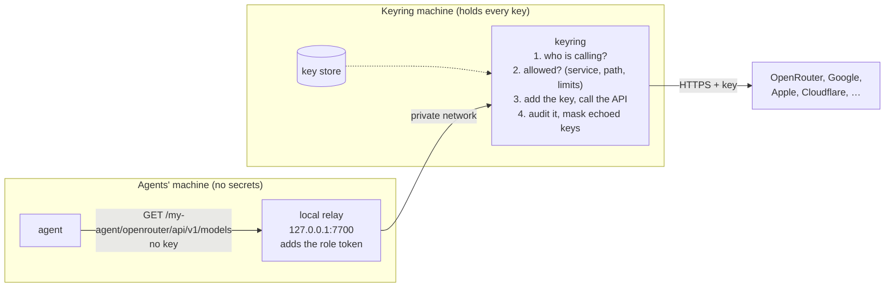
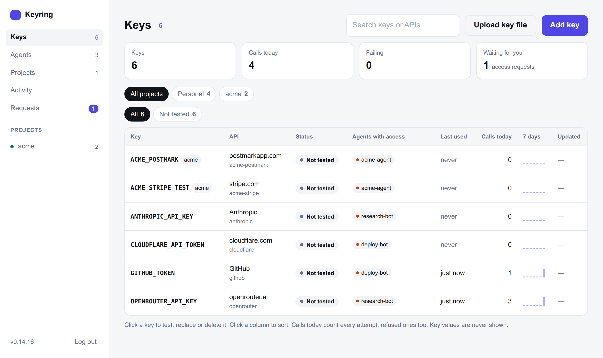

# keyring

**A vault for AI agents.** Agents call APIs, sign requests and use OAuth *through* the keyring, and never see a secret.

[](https://github.com/gitmoot/keyring/releases)
[](https://github.com/gitmoot/keyring/actions/workflows/ci.yml)
[](LICENSE)
[](go.mod)

## Why

Agents need real credentials to do real work: an LLM API key, a Google account, an Apple signing key. Giving them the keys is the risk. An agent that can read a key can leak it into a chat, a pull request or a log, and every agent on the machine can read every key in its `.env`.

The keyring keeps the keys on a **separate machine**. An agent sends its request without a key; the keyring checks who is asking and whether that is allowed, adds the key, calls the API and passes the answer back. There is nothing on the agents' machine to read or leak.

## How it works



The key never leaves the keyring machine. The agent holds only a role token, which the owner can limit, watch and revoke.

## What it does

- **API proxy.** Bearer (or another `Authorization` scheme, such as `Key`), header or query-parameter keys, up to two extra secret headers, keys with several values, and [key pools](docs/proxy.md#key-pools-several-keys-behind-one-service) that switch to the next key when one is refused or runs out. Paths are normalised, keys echoed back by an API are masked, redirects are not followed. [Proxy](docs/proxy.md)
- **Request signing without handing out the private key.** Apple Ads and App Store Connect JWTs, Sign in with Apple client secrets, APNs push, raw Ed25519, and minisign release signatures. [Apple](docs/apple.md) · [Signing](docs/signing.md)
- **OAuth with refresh.** The keyring holds the refresh token and mints access tokens, for Gmail, Drive and any OAuth 2 provider; Google accounts can also come from `gcloud`. [OAuth](docs/oauth.md) · [Google via gcloud](docs/google-gcloud.md)
- **Per-agent access.** Each agent (a *role*) gets only the services, methods and paths it was given, with daily request and byte limits and an end date. Agents find services with `keyring services --search`, ask with `keyring request`, and the owner approves in one tap. [Finding services](docs/proxy.md#finding-services)
- **Projects.** Group a client's services, give an agent a whole project, pause it or let it expire in one place. [Projects](docs/projects.md)
- **Dashboard and audit.** Add, test, replace and upload keys; see each key's status and use; approve agents; search the audit log of every call. [Dashboard](docs/dashboard.md)
- **Consent links.** Send a person a one-time link to connect their own account (OAuth sign-in) or paste a key, instead of sending it in a chat. [Consent links](docs/consent-links.md)
- **Egress tunnels.** Let an agent's traffic leave through a person's own proxy, with the proxy credential kept in the keyring. [Egress proxy](docs/egress-proxy.md)
- **One keyring per person.** Instance mode runs a small keyring per user under a supervisor, for example on Cloudflare Containers. [Instance mode](docs/instance-mode.md)



## Quick start (5 minutes, one machine)

This runs the keyring and the relay on one machine so you can see a call go through. In real use the keyring runs on a different machine from the agents; see [Relay](docs/relay.md).

**1. Install.** Download a binary from [Releases](https://github.com/gitmoot/keyring/releases) (macOS arm64, Linux amd64; check it against `SHA256SUMS`), or build it:

```sh
go install github.com/gitmoot/keyring/cmd/keyring@latest
```

**2. Store a key.** The value is read from stdin and never echoed.

```sh
mkdir -m 700 demo && cd demo
keyring set --store keys.json OPENROUTER_API_KEY
```

**3. Make a token for your agent.** It prints a token (for the agent's side) and its SHA-256 (for the keyring).

```sh
keyring new-token
```

**4. Say who may connect, and what the agent may do.**

```sh
cat > rules.json <<EOF
{"listen": "127.0.0.1:7701", "allow_sources": ["127.0.0.1"],
 "audit_log": "$PWD/audit.log", "access_file": "$PWD/access.json"}
EOF
cat > access.json <<'EOF'
{"services": {"openrouter": {"base": "https://openrouter.ai", "key": "OPENROUTER_API_KEY", "auth": "bearer"}},
 "roles": {"my-agent": {"token_sha256": "<sha256 from step 3>",
                        "access": {"openrouter": {"paths": ["/api/v1"], "daily_requests": 100}}}}}
EOF
chmod 600 rules.json access.json
keyring check --config rules.json --store keys.json
keyring serve --config rules.json --store keys.json
```

**5. Start the relay** (in another terminal; on a real setup this is the agents' machine). It holds the token, never a key.

```sh
mkdir -m 700 tokens && (umask 077; echo '<token from step 3>' > tokens/my-agent.token)
keyring relay --listen 127.0.0.1:7700 --upstream http://127.0.0.1:7701 --tokens "$PWD/tokens"
```

**6. Call the API without a key.**

```sh
curl http://127.0.0.1:7700/my-agent/openrouter/api/v1/models   # works: the keyring adds the key
curl http://127.0.0.1:7700/my-agent/openrouter/admin           # 403: path not allowed for this role
tail -2 audit.log                                              # both calls, never the key
```

SDKs work the same way: set the base URL to `http://127.0.0.1:7700/my-agent/openrouter/api/v1` and use any placeholder key.

Next: [turn on the dashboard](docs/dashboard.md), [install on a Mac](deploy/mac/README.md), or read the [configuration reference](docs/configuration.md).

## Security model

**What it protects against**

- **Key theft from the agents' machine.** No key is stored there; an agent, a prompt injection or a leaked log has no key to copy.
- **Keys leaking through replies.** A key echoed by an API (in headers or body, plain, URL-encoded or JSON-escaped, even split across chunks) is replaced with `[REDACTED]`; replies the keyring cannot inspect are refused.
- **Agents doing more than they were given.** Each role is limited to its services, methods and paths, with daily limits and an end date. Signing services hand out signatures or short-lived tokens, never the private key.
- **Not knowing what happened.** Every call is written to an audit log (role, service, method, path, status) without keys, tokens, bodies or query strings.

**What it does not protect against**

- **Misuse of granted access.** An agent can do anything its grant allows, with the real key behind it. Grant the smallest paths and limits that work.
- **A compromised agents' machine.** Role tokens live there; whoever controls that machine can call the keyring as any of its roles (but still cannot read a key), until the tokens are revoked.
- **A compromised keyring machine.** It holds every key. Run it on a machine you control, reachable only from your agents (a private network, `allow_sources`), with the dashboard on loopback or behind its HTTPS proxy.
- **Signed tokens after they are issued.** An Apple JWT or OAuth access token is usable until it expires, even after the grant is removed.
- **APIs that echo a key in an encoding it does not check** (for example base64 inside other text). Don't route such an API through it.
- **Availability.** If the keyring machine is off, calls fail. They never fall back to local keys.

## Docs

| Topic | |
|---|---|
| [Configuration](docs/configuration.md) | Commands, `rules.json`, `access.json`, reloads |
| [Proxy](docs/proxy.md) | What happens to each call; service settings, extra and fixed headers, multi-value keys, pinned certificates |
| [Relay](docs/relay.md) | The agents' side: token files, health check, Docker |
| [Dashboard](docs/dashboard.md) | Web UI, safety rules, Activity page, access requests |
| [Projects](docs/projects.md) | Group, pause and expire a client's services |
| [OAuth](docs/oauth.md) | Refresh tokens, Gmail and other providers |
| [Google via gcloud](docs/google-gcloud.md) | Personal and business Google accounts, renewal and recovery |
| [Consent links](docs/consent-links.md) | One-time links for a person to connect their account |
| [Apple](docs/apple.md) | Apple Ads, App Store Connect, Sign in with Apple, APNs |
| [Signing](docs/signing.md) | Ed25519 and minisign |
| [Egress proxy](docs/egress-proxy.md) | Tunnels through a person's own proxy |
| [Instance mode](docs/instance-mode.md) | One keyring per person, under a supervisor |
| [Mac install](deploy/mac/README.md) · [Cloudflare](deploy/cloudflare/README.md) | Deployment |

## License

[Apache License 2.0](LICENSE). See [NOTICE](NOTICE).
