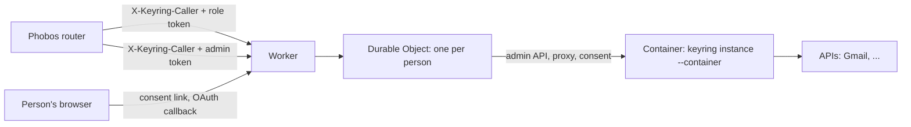

# Per-person keyrings on Cloudflare Containers

One keyring per person (gitmoot/keyring#46, option B1). Each person gets a container running `keyring instance --container`, controlled by one Durable Object (DO) per person. The owner's Mac install does not use any of this.



## What lives where

The DO keeps each item under its own storage key, so writers of different items never overwrite each other. A delete sets a flag before its first await: after that, nothing starts the container or writes storage, and the container is destroyed even while it is still starting.


| Item | Where | Notes |
|---|---|---|
| Key values, roles, services | the container's memory, and the DO as a **sealed state** (AES-256-GCM) | the DO never decrypts it |
| Data key | derived by HKDF from the `MASTER_KEY` secret and a random per-keyring salt kept in the DO | deleting the DO's storage destroys the salt, so no copy of the state can be opened again |
| Daily counts | the container; the DO saves `GET /usage` every minute and before stopping the container, and passes it back on unlock | a restart does not reset a daily limit |
| Consent links | the container's memory | the DO keeps the container running until the last link and its sign-in have expired (#50) |
| Audit | the container's stdout (Workers logs) | never a key value or token |
| Container disk | transient Google CLI configuration under private `/run/keyring/google` | never a durable credential store; persisted credentials belong in sealed state |

## Routes

- `/p/<keyring_id>/<service>/<path>`: proxy. Needs `X-Keyring-Caller` and `X-Keyring-Token`. The Worker checks the caller proof in constant time before the DO is touched and removes it; the DO and the keyring also never forward it.
- `/admin/instances...`: admin API for the router. Needs `X-Keyring-Caller` and `Authorization: Bearer <ADMIN_TOKEN>`:
  - `POST /admin/instances {"label"}` → 201 `{"keyring_id", "keyring_base", "role_token"}`. The role token is shown only once.
  - `POST /admin/instances/<id>/links {"service", "ttl_seconds", "label"}` → `{"url", "expires_at"}`
  - `GET /admin/instances/<id>/services` → `{"services": [{"name", "connected", "failing"}]}`
  - `PUT /admin/instances/<id>/services/<name> {"service": {...}, "access": {...}}`: exceptions to the template
  - `DELETE /admin/instances/<id>/keys/<service>`: revokes at the provider (OAuth) and deletes
  - `POST /admin/instances/<id>/role-token` → `{"role_token"}`; the old token stops working
  - `DELETE /admin/instances/<id>`: wipes the container and the DO's storage; repeating it returns 200
- `/connect/<keyring_id>/c/<link>` and `/connect/callback`: public pages for the person. A link opens only while that keyring's container is running and the link is open, so a stranger cannot wake a container. The callback finds its keyring through a short-lived `__Host-` cookie; the keyring itself still checks the OAuth state, PKCE and its own browser cookie.

## Deploying (needs the owner's approval: changes the Cloudflare account and costs money)

Inputs:

| Name | Kind | Value |
|---|---|---|
| `PUBLIC_BASE` | var in `wrangler.jsonc` | https origin of the Worker, e.g. `https://keyring.example.com` |
| `SERVICES_TEMPLATE` | var in `wrangler.jsonc` | services each keyring starts with, and the router role's access |
| `MASTER_KEY` | secret | `head -c32 /dev/urandom \| base64`. Losing it makes every keyring unreadable; rotating it needs a re-seal (not built yet) |
| `CALLER_SECRET` | secret | the router's `X-Keyring-Caller` value, one per Phobos server |
| `ADMIN_TOKEN` | secret | the router's admin bearer token |
| `OAUTH_CLIENT_SECRETS` | secret | JSON `{"GOOGLE_CLIENT_SECRET": "..."}`, pushed into every keyring |

Gmail's OAuth flow needs a Web application client with redirect URI `<PUBLIC_BASE>/connect/callback` and its client ID in the template. The separate Drive connection below uses Google's own `gcloud` client and needs no Phobos-owned OAuth application.

```sh
cd deploy/cloudflare
npm ci
npx wrangler secret put MASTER_KEY        # and CALLER_SECRET, ADMIN_TOKEN, OAUTH_CLIENT_SECRETS
npx wrangler deploy                        # builds the image from the repository root
```

Deploying without editing `wrangler.jsonc` (for example from a checkout you do not change):

```sh
npx wrangler deploy \
  --domain connect.example.com \
  --var PUBLIC_BASE:https://connect.example.com \
  --var "SERVICES_TEMPLATE:$(cat /path/to/services-template.json)"   # optional; a JSON string is accepted
```

After `wrangler deploy` returns, the container image can stay "provisioning" for several minutes (seen: about 4). In that window new keyrings may start on the **old** image with the **new** template. Wait until `npx wrangler containers list` shows the application ready before creating keyrings.

`--domain` adds the Worker's custom domain and its DNS record only; other records in the zone are not touched. Until a Google OAuth client exists, the template's `REPLACE` client id only breaks the Gmail sign-in; fixed-key services, consent forms, the caller check and deletes all work. Add a fixed-key service to a keyring with `PUT /admin/instances/<id>/services/<name>`.

## Per-person Drive and Sheets

The `drive` consent entry (`auth: gcloud-login`, `google_account: me`) opts new
instances into fixed Google services. For existing instances, call
`POST /admin/instances/<id>/google-drive` with JSON `{}` using the existing caller
proof and admin bearer token, then request the normal `service: drive` connection
link. Provisioning is atomic and repeatable: it preserves the router token and
unrelated services/grants. It returns `200 {"version":N}` only after sealed-state
sync, `400` for an invalid/nonempty body, `401` for failed authentication, `404`
for an unknown instance, `409` for incompatible reserved service/grant definitions,
and the existing `502` failure shape when the container or state save is unavailable.
Provisioning is not sign-in.

The one-time link opens a browser-bound `/connect/<id>/g/<flow>` page. The person
opens Google's URL and enters its verification code **only on that private page**,
never in chat. Login runs in that person's container with the SDK's own OAuth
client and `--enable-gdrive-access`. Setup retains one project ID across retries,
enables Drive and Sheets, and checks the selected identity. Cloud terms refusal
links to Google Cloud Console and offers an explicit retry without discarding
the completed login. No billing account is attached. This relies on Google
continuing to permit the SDK flow; it does not bypass reauthentication or policy.

| Service | Methods | Path prefixes |
|---|---|---|
| `google-me-drive` | GET, POST | `/about`, `/files`, `/changes`, `/drives` |
| `google-me-upload` | POST, PATCH | `/files` (17 MiB request limit) |
| `google-me-sheets` | GET, POST | `/spreadsheets` |

Permission-management endpoints and DELETE are refused. `drive` itself cannot
proxy requests. `GET /admin/instances/<id>/services` reports the four services as
connected only after login/project setup is saved, with a safe failure hint;
it exposes no Google account, project, authorization URL, code, or credential.

SDK credentials are bounded opaque database snapshots (256 KiB total), in a
dedicated field of the instance's encrypted state, never in forwarded keys.
Only the fixed image executable and a generated private directory beneath
`/run/keyring/google` are allowed. SDK writers are serialized; a refresh is sealed
before its access token is returned. The supervisor syncs proxy/consent changes
and checks active setup before idle shutdown. A platform kill during an unfinished
browser flow expires that flow; saved login/project progress can be retried
through a new link after wake.

`DELETE /admin/instances/<id>/keys/drive` disables all three APIs in sealed state
first, invalidates old flow capabilities, cancels/joins SDK writers, attempts
remote revocation, and removes local credentials. A remote revocation failure
returns `502` explicitly even though local access remains disabled; it never
restores the deleted login. The supervisor saves that denial on error responses
too. A new login is blocked until cleanup finishes. Disconnect does not delete
the person's Google Cloud project or files.
This Worker route uses the consent API's service namespace. The container admin
API's `/keys/<name>` remains a raw-key namespace: a stored key named `drive` is
unrelated and can still be deleted normally.

Deploy the compatible Worker and image before enabling caller provisioning.
No instance-size, instance-count, migration, or additional secret change is
required. After provisioning, the older pre-feature image cannot load that
person's new Google configuration. Retain current sealed state and a compatible
image; pause new connections and disconnect affected accounts if a repair is
needed. Do not restore old snapshots over newer unrelated credentials or grants.
Old-image rollback is limited to never-provisioned instances. The caller can be
rolled back independently while the compatible Keyring image remains deployed.

## Container image runtime

`Dockerfile` retains the Go build, non-root UID/GID `65532:65532`, keyring entrypoint and port `8090`. Its runtime is Debian Bookworm slim rather than `scratch`: glibc and `libstdc++6` support the SDK's bundled Python and native extensions, and `ca-certificates` supplies TLS trust roots. Base images use release tags, matching the existing `golang:1.24-alpine` convention; these are not immutable digest pins.

The Linux amd64 image installs the official [Google Cloud CLI 589.0.0 archive](https://dl.google.com/dl/cloudsdk/channels/rapid/downloads/google-cloud-cli-589.0.0-linux-x86_64.tar.gz) at `/opt/google-cloud-sdk`. The download must match SHA256 `f865da648f6fdae2015abb5b32eaa0eb10520e88f0ca735cfb33795868c8d26f` before extraction; a mismatch fails the build. This checksum is from the preserved versioned archive whose extracted payload was previously compared with the documented archive. The preserved version smoke reported SDK `589.0.0` and bundled Python `3.14.8`; it was not a smoke of this image.

The executable is fixed at `/opt/google-cloud-sdk/bin/gcloud`, with `CLOUDSDK_PYTHON` selecting the bundled interpreter. The root-owned SDK is not writable by the keyring process. `/run/keyring` and `/run/keyring/google` are created with mode `0700`, owned by the runtime UID/GID. Linux process groups are available for the keyring process to manage CLI children. The recipe copies only application source/build output and the public SDK: no credentials, login, or OAuth app setup belongs in an image layer.

After building locally for `linux/amd64`, these offline smoke commands check the real image without credentials or Google traffic (replace `keyring-container-google` with the local image tag):

```sh
docker run --rm --network none \
  --entrypoint /opt/google-cloud-sdk/bin/gcloud keyring-container-google version
docker run --rm --network none \
  --entrypoint /opt/google-cloud-sdk/platform/bundledpythonunix/bin/python3 \
  keyring-container-google -c \
  'import ssl, sqlite3; c = ssl.create_default_context(cafile="/etc/ssl/certs/ca-certificates.crt"); assert c.cert_store_stats()["x509_ca"] > 0; print(ssl.OPENSSL_VERSION, sqlite3.sqlite_version)'
```

These commands require a local container engine and the built image. Building fetches public base images, Debian packages and the pinned SDK archive; the smoke commands themselves disable networking. No production deployment is implied.

The offline check explicitly loads the installed CA bundle. The default context
uses `/etc/ssl/certs` lazily; zero certificates before a handshake does not mean
its trust store is missing.

## Checking it without Cloudflare

`smoke/smoke.ts` runs the Worker and DO code in Bun against the real binary, with fakes for `cloudflare:workers` and the container runtime:

```sh
go build -o /tmp/keyring ./cmd/keyring
cd deploy/cloudflare && npm ci && npx tsc --noEmit
KEYRING_BIN=/tmp/keyring bun smoke/smoke.ts
```

`wrangler dev` with local containers was tried on the seat's Linux host. Workerd's egress sidecar timed out before it created the keyring container, so behaviour under the real Containers runtime (cold start, `monitor`, `signal`, sleep) is only verified after a first deploy.

## Limits

- One `MASTER_KEY` for all keyrings. A Cloudflare account compromise exposes all keys (the owner accepted this when choosing B1).
- Calls made after the last usage save are lost if a container crashes; this only matters for the daily limit.
- Consent links end if a container is stopped by the platform before they expire.
