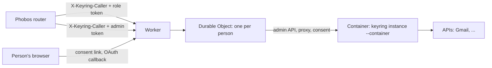

# Per-person keyrings on Cloudflare Containers

One keyring per person (gitmoot/keyring#46, option B1). Each person gets a container running `keyring instance --container`, controlled by one Durable Object (DO) per person. The owner's Mac install does not use any of this.



## What lives where

The DO keeps each item under its own storage key, so writers of different items never overwrite each other. A delete sets a flag before its first await: after that, nothing starts the container or writes storage, and the container is destroyed even while it is still starting.


| Item | Where | Notes |
|---|---|---|
| Key values, roles, services | the container's memory, and the DO as a **sealed state** (AES-256-GCM) | the DO never decrypts it |
| Data key | derived by HKDF from the `MASTER_KEY` secret and a random per-keyring salt kept in the DO | deleting the DO's storage destroys the salt, so no copy of the state can be opened again |
| Daily counts | the container; the DO saves `GET /usage` every minute and before stopping the container, and passes it back on unlock | a restart does not reset a daily limit |
| Consent links | the container's memory | the DO keeps the container running until the last link and its sign-in have expired (#50) |
| Consent public URL | the container's sealed state; the DO keeps the last one sent (`consentPublicUrl`) | follows `PUBLIC_BASE`; see [Changing `PUBLIC_BASE`](#changing-public_base) |
| Audit | the container's stdout (Workers logs) | never a key value or token |
| Container disk | transient Google CLI configuration under private `/var/lib/keyring/google` | never a durable credential store; persisted credentials belong in sealed state |

## Routes

- `/p/<keyring_id>/<service>/<path>`: proxy. Needs `X-Keyring-Caller` and `X-Keyring-Token`. The Worker checks the caller proof in constant time before the DO is touched and removes it; the DO and the keyring also never forward it.
- `/admin/instances...`: admin API for the router. Needs `X-Keyring-Caller` and `Authorization: Bearer <ADMIN_TOKEN>`:
  - `POST /admin/instances {"label"}` → 201 `{"keyring_id", "keyring_base", "role_token"}`. The role token is shown only once.
  - `POST /admin/instances/<id>/links {"service", "ttl_seconds", "label"}` → `{"url", "expires_at"}`
  - `GET /admin/instances/<id>/services` → `{"services": [{"name", "connected", "failing"}]}`
  - `PUT /admin/instances/<id>/services/<name> {"service": {...}, "access": {...}}`: exceptions to the template
  - `DELETE /admin/instances/<id>/keys/<service>`: removes the local credential and pending OAuth consent, then attempts bounded provider revocation; inspect `revoked`/`revoke_error`, not just HTTP 200
  - `POST /admin/instances/<id>/role-token` → `{"role_token"}`; the old token stops working
  - `DELETE /admin/instances/<id>`: wipes the container and the DO's storage; repeating it returns 200
- `/connect/<keyring_id>/c/<link>` and `/connect/callback`: public pages for the person. A link opens only while that keyring's container is running and the link is open, so a stranger cannot wake a container. The callback finds its keyring through a short-lived `__Host-` cookie; the keyring itself still checks the OAuth state, PKCE and its own browser cookie. A link page requested on another host than `PUBLIC_BASE` answers 303 to the same path on `PUBLIC_BASE`.

## Deploying (needs the owner's approval: changes the Cloudflare account and costs money)

Inputs:

| Name | Kind | Value |
|---|---|---|
| `PUBLIC_BASE` | var in `wrangler.jsonc` | https origin of the Worker, e.g. `https://keyring.example.com`; may change, see [Changing `PUBLIC_BASE`](#changing-public_base) |
| `SERVICES_TEMPLATE` | var in `wrangler.jsonc` | services each keyring starts with, and the router role's access |
| `MASTER_KEY` | secret | `head -c32 /dev/urandom \| base64`. Losing it makes every keyring unreadable; rotating it needs a re-seal (not built yet) |
| `CALLER_SECRET` | secret | the router's `X-Keyring-Caller` value, one per Phobos server |
| `ADMIN_TOKEN` | secret | the router's admin bearer token |
| `OAUTH_CLIENT_SECRETS` | secret | JSON `{"GOOGLE_CLIENT_SECRET": "..."}`, pushed into every keyring |
| `OAUTH_CLIENT_SECRETS_BY_INSTANCE` | secret | JSON `{"keyring_id": {"GOOGLE_CLIENT_SECRET": "..."}}`, imported only by the named keyring; overrides matching global names there |

Gmail and Calendar need an owner-approved Web application OAuth client with redirect URI `<PUBLIC_BASE>/connect/callback`; put the same client ID in both service entries. For a personal pilot, update only that person's existing instance, not the global template. The separate Drive connection below uses Google's own `gcloud` client and needs no Phobos-owned OAuth application. Do not publish a Google project, create shared credentials, or deploy the sample Workspace grants without the owner's approval.

```sh
cd deploy/cloudflare
npm ci
npx wrangler secret put MASTER_KEY        # and CALLER_SECRET, ADMIN_TOKEN; OAuth bindings only when approved
npx wrangler deploy                        # builds the image from the repository root
```

Deploying without editing `wrangler.jsonc` (for example from a checkout you do not change):

```sh
npx wrangler deploy \
  --domain connect.example.com \
  --var PUBLIC_BASE:https://connect.example.com \
  --var "SERVICES_TEMPLATE:$(cat /path/to/services-template.json)"   # optional; a JSON string is accepted
```

After `wrangler deploy` returns, the container image can stay "provisioning" for several minutes (seen: about 4). In that window new keyrings may start on the **old** image with the **new** template. Wait until `npx wrangler containers list` shows the application ready before creating keyrings.

`--domain` adds the Worker's custom domain and its DNS record only; other records in the zone are not touched. The template's `REPLACE` client ID is not a working OAuth client. Until an approved client and secret exist, Gmail/Calendar activation is blocked; fixed-key services, consent forms, the caller check and deletes still work. Add a fixed-key service with `PUT /admin/instances/<id>/services/<name>`.

### Changing `PUBLIC_BASE`

Each keyring builds its link, Google page and callback URLs from the consent `public_url` in its sealed state (`<PUBLIC_BASE>/connect`, sent at create). After a deploy with a new `PUBLIC_BASE`, every keyring gets it again with `PUT /consent` on its next start (the first call after the deploy restarts its DO), before any link is issued or page served; the new sealed state is saved and the DO records the URL under `consentPublicUrl`, so this happens once per change. Open links, keys and accounts are kept. A keyring made before this record existed gets one such `PUT` on its first start, even if `PUBLIC_BASE` did not change.

Before switching, attach the new hostname to the Worker and add `<new PUBLIC_BASE>/connect/callback` to the OAuth client. Keep the old hostname and its callback URI for at least the longest link lifetime (15 minutes by default, up to 1 hour with `ttl_seconds`) plus a 10-minute sign-in:

- A link issued before the switch still works: on the old host its page answers 303 to the new host, where it opens and submits normally. A form opened before the switch and submitted after it lands on the page again on the new host.
- A sign-in started before the switch (Connect pressed on the old host) does not finish: the OAuth callback on the old host exchanges the code with the new callback URL, which the provider refuses, and a Drive code form posted on the old host fails the keyring's Origin check. The person asks for a new link. This affects only sign-ins started in the 10 minutes before the switch.

## Per-person Gmail and Calendar

The reference template uses one Google Workspace consent grant, separate from
the existing Drive SDK login. `gmail` and `calendar` share
`GOOGLE_WORKSPACE_REFRESH_TOKEN`, the same Web client and identical OAuth
settings. A connection link for either asks for both services. An explicitly
partial scope grant is rejected without replacing an existing credential.
OAuth providers may omit `scope` only when it is unchanged from the request
(RFC 6749 section 5.1).

| Service | Base | Required scopes (all prefixed `https://www.googleapis.com/auth/`) |
|---|---|---|
| `gmail` | `https://gmail.googleapis.com` | `gmail.modify` |
| `calendar` | `https://www.googleapis.com` | `calendar.events`, `calendar.calendarlist.readonly`, `calendar.events.freebusy` |

Gmail paths retain `/gmail/v1/users/me/...`; Calendar paths retain
`/calendar/v3/...`. Account-binding reads are Gmail `users/me/profile`
(`emailAddress`) and Calendar `users/me/calendarList/primary` (`id`).
Gmail signature reads at `users/me/settings/sendAs` need no settings-write
scope. `calendar.events` alone does **not** authorize `freeBusy.query`.
The profile does not request permanent mailbox deletion, calendar ACL/sharing,
or full-mail/full-calendar scopes.

The template grants only named API path families, but grants are not action
approval. Phobos must keep these services out of unrestricted guest HTTP and
enforce its own exact operation allowlist and durable confirmation before
send, trash/delete, or attendee-changing operations. That includes the
signature-expanded outgoing message and Calendar `If-Match`/`sendUpdates`
controls. MCP receives API responses through Keyring, not Google credentials.

### Provisioning and lifecycle

1. An authorized deployment operator provisions or selects the approved Web
   OAuth client and publishing mode, then installs its secret through protected
   setup (`OAUTH_CLIENT_SECRETS_BY_INSTANCE` for a personal pilot). The end user
   must not be required to create a Google app, project or client.
   Use a project separate from Drive:
   [Google combined grants can revoke all included scopes together](https://developers.google.com/identity/protocols/oauth2/javascript-implicit-flow#incrementalAuth).
   Two refresh-token strings under one client are not independent revocation
   boundaries.
2. New instances use the template. For an existing instance, PUT the `gmail`
   and `calendar` service/access entries through the existing admin route.
   Configure both before sending a consent link; the two PUTs are not atomic.
   No Drive service, role token, SDK snapshot or instance size needs changing.
   Both services must share the exact OAuth settings and refresh key.
3. POST a normal `links` request for `gmail` or `calendar`. The browser-bound
   code/PKCE callback stores the refresh token in the person's sealed state.
   The client secret is a separate protected key and cannot be a service key.
4. Verify authenticated identity reads through both proxy routes. `connected`
   reflects a stored credential with no observed permanent provider rejection,
   not a promise that the next API call will work. Rejected refresh/client
   credentials make both services disconnected with a safe `failing` hint.
   `invalid_grant` needs fresh consent; client/setup errors need operator repair.
   Failure observations are in-memory and are re-established by actual calls
   after restart; credentials themselves survive sealed-state restoration.
5. DELETE `keys/gmail` **or** `keys/calendar` disconnects **both**, not Drive.
   Local removal invalidates unopened links and in-flight callbacks before the
   bounded remote revocation attempt. New consent for that key is refused
   while revocation is pending. A renewal already in progress cannot forward
   a token after its credential/binding changes; a request already sent to
   Google cannot be recalled.
6. HTTP 200 with `deleted:true, revoked:false, revoke_error:...` means local
   removal succeeded but remote revocation is unconfirmed. Do not report it
   as successful Google revocation. Wait for the completed response/sealed
   state sync before treating disconnect as durable. A new browser-bound
   connection may then be requested; do not restore an older sealed snapshot.

### Operator-managed client provisioning

The service owner authorizes the deployment operator. Delegation does not
waive the owner's approval gates for credentials, publishing, deployment,
spending or permissions.

App/project/client creation and protected credential provisioning belong to
the deployment operator, not the person connecting Gmail and Calendar.
The operator uses an authorized Google Cloud console session for the approved
Web OAuth client and installs its secret directly into the Worker's protected
`OAUTH_CLIENT_SECRETS_BY_INSTANCE` setting in Cloudflare. The connecting person
only signs in and consents to approved scopes. Do not put secret values in a
command argument, chat, issue, agent tool, repository file, MCP worker or guest.

If no authorized operator session or approved client is available, report that
operator prerequisite; do not send the person an app-creation checklist.
An existing managed connection is an alternative only after verifying its
authorization and Keyring-only token custody. Do not borrow the Drive SDK's
client for Gmail/Calendar or assume new service grants, spending or changes
to shared security are approved.

The JSON object's outer key is the person's exact existing `keyring_id`,
not a contact ID, label or role token. Its value maps the configured
`client_secret_key` name to the secret. Preserve any other approved entries
when replacing the binding. Keep personal-pilot secrets out of
`OAUTH_CLIENT_SECRETS`, which intentionally imports into every instance.
Instance-specific entries override global entries with the same key name;
other instances continue using their existing global values.

Import happens when the instance starts, and is saved in its sealed state.
Removing a binding entry is **not revocation** and does not erase a previously
imported key. For withdrawal, revoke the Google grant/client credential through
the provider and disconnect the Workspace connection; do not infer removal
from a changed binding alone. Public admin APIs still do not accept raw secrets.

Agents need only non-secret project/client identifiers, the confirmed redirect
URI, the target keyring ID and an operator-reported protected-import receipt.
Review, deployment and service-grant approval gates must pass before sending
a real consent link.

#### Initial opaque pipe import

`keyring cloudflare-import-client` is a Linux/macOS **sink**, not a Google
console credential extractor. Before generating a client secret, the operator
must have an approved producer that can connect the value directly to this
command's inherited anonymous stdin pipe, without returning it to agent tools,
screenshots, DOM dumps, logs, environment variables or files. Do not ask the
connecting person to copy the secret.

Confirm the pilot ID from the authenticated person's canonical contact/keyring
mapping. Confirm the existing Cloudflare account, Worker and loopback Keyring
relay service, using only non-secret metadata. Preflight needs no secret input:

```sh
keyring cloudflare-import-client \
  --relay-base "$CLOUDFLARE_RELAY_BASE" \
  --account "$CLOUDFLARE_ACCOUNT_ID" \
  --worker "$KEYRING_WORKER" \
  --keyring-id "$PILOT_KEYRING_ID" \
  --check-only
```

`CLOUDFLARE_RELAY_BASE` is the existing numeric-loopback relay URL ending in the
Cloudflare API prefix, for example the approved role/service route ending in
`/client/v4`. Authentication stays in that relay; this command neither reads
an API key nor grants permissions. A failed preflight must stop provisioning.

For the import, the operator's producer launches the same command with
`--exclusive-writer` instead of `--check-only`. Its pipe must contain the exact
UTF-8 client-secret value, with no trailing newline or JSON wrapper. The command
does not accept a secret argument, regular file, named FIFO or terminal input.
It creates only `{"<confirmed keyring_id>":{"GOOGLE_CLIENT_SECRET":"..."}}`
inside `OAUTH_CLIENT_SECRETS_BY_INSTANCE`; both pilot services must use
`GOOGLE_CLIENT_SECRET` as their configured `client_secret_key`.

This is an **initial import only**. It refuses an existing binding of any type
with that name, rather than overwriting unknown per-instance entries. It checks
binding metadata again immediately before one
[Cloudflare single-secret PUT](https://developers.cloudflare.com/api/resources/workers/subresources/scripts/subresources/secrets/methods/update/)
and verifies the returned name/type plus unchanged unrelated binding names/types.
It never replaces bulk Worker settings or the global OAuth secret binding.
Cloudflare supplies no compare-and-set here: `--exclusive-writer` attests that
the operator has excluded other deployment/secret writers for the entire import;
the flag is not a distributed lock. This command is not an existing-map merge
or credential-rotation interface.

Redirects and environment proxies are disabled, provider response/error bodies
are not printed, and ambiguous writes are not retried. On failure after
submission, stop and reconcile with the deployment owner; do not blindly repeat
or delete an existing binding. The non-secret JSON receipt reports metadata
acknowledgment only: `value_readback` and `runtime_import_verified` remain false.
Compatible Worker/container deployment, instance startup/import and real-account
acceptance are separate gates. No public receiver or additional permission is
introduced by this command.


### Pilot authorization is not public-launch approval

[External OAuth apps in Testing receive seven-day refresh tokens](https://developers.google.com/identity/protocols/oauth2#expiration)
for these scopes. Testing therefore requires repeat consent and cannot be
described as durable unattended access. The owner must explicitly approve any
change from Testing to an In Production personal-pilot project.
[Google's personal-use verification exception](https://support.google.com/cloud/answer/13464323?hl=en)
applies to fewer than 100 users with an unverified-app warning. It is not
public-launch authorization or a blanket exemption from user-data policy or
restricted-scope security-assessment requirements. Gmail scopes are restricted;
review the [Gmail scope requirements](https://developers.google.com/workspace/gmail/api/auth/scopes)
before expanding beyond the approved pilot.

In Production removes the Testing-specific seven-day limit, not all expiry:
user revocation, Gmail password changes, inactivity, token-count limits,
time-limited grants and Workspace admin policy can still require consent.
Real permitted-account consent, refresh, revocation/reconnect and both service
reads remain release gates. Offline fixtures do not satisfy them.

### Multiple Workspace accounts

Multiple Gmail/Calendar accounts are opt-in inside the existing person's instance.
Each slot has an immutable opaque `account_id`, a stable alias
(`[a-z][a-z0-9-]{0,31}`), and a `binding_generation`. `personal` is the migrated
legacy default. An ID identifies the local slot, not a Google subject.
Gmail and Calendar share one refresh grant **per slot**; Drive remains separate.

All account administration below uses the existing caller proof and admin token.
Prefix routes with `/admin/instances/<instance>`.

| Method and route | Request and result |
|---|---|
| `GET /accounts` | `{accounts, default_account_id, migration_required}`; cached metadata only |
| `POST /accounts/migrate` | Idempotent, metadata-only adoption of the existing Workspace key and role grants; returns `{account}` |
| `POST /accounts` | `{alias}`; creates a disconnected slot, returns `{account}` |
| `POST /accounts/<account>/identity` | Requires `X-Keyring-Binding-Generation`; explicit identity hydration, returns `{account}` |
| `POST /accounts/<account>/links` | `{service:"gmail"|"calendar", ttl_seconds?:900}` and generation header; existing TTL bounds/default apply; returns `url`, `expires_at`, `account_id`, `alias`, `affected_services` |
| `DELETE /accounts/<account>` | Requires generation header and caller-side shared-grant confirmation; returns `{account, provider_revoked}` |

Account views contain `account_id`, `alias`, `default`, `provider`,
`binding_generation`, nullable `email` / `email_verified_at`, `identity_state`,
`connected`, `status`, `affected_services`, and per-service `connected` / `failing`
fields. Status can be `connected`, `identity_pending`, `reconnect_required`,
`revoking`, or `disconnected`. Credentials and internal key references are never
returned. A disconnected slot retains its last verified identity, explicitly
marked disconnected.

Listing may start/unlock the container through the normal status lifecycle, but
does not refresh tokens or fetch provider identity. Existing grants migrate
without reconnect; their identity is honestly `unknown` until the operator
explicitly hydrates it. Hydration uses the already-approved Gmail profile scope,
not new OIDC scopes, and caches verified email for that binding. Concurrent
hydration is serialized; cached reads make no Google call. New consent verifies
email before publishing credentials. Adding another slot is refused while a
connected slot has an unknown identity; duplicate connected identities are
refused without revoking an already-active Google grant.

After migration, the Gmail/Calendar service key references cannot be renamed:
configuration changes that would detach the immutable default are rejected
without changing state. Rotate a stored credential or reconnect its slot instead.
Unrelated state changes preserve account token caches and cached refresh failures.

Account-qualified proxy requests use
`/p/<instance>/_accounts/<account>/<gmail|calendar>/<path>`, the existing role
token/caller proof, and `X-Keyring-Binding-Generation`. The account gets separate
grants capped by the current role policy. Requests still consume the existing
aggregate role/service daily quota: adding an account does not reset it.
The generation header is removed before forwarding.

The caller resolves an omitted account only when exactly one eligible account
exists. Writes and shared-grant disconnect approvals bind ID, verified email and
generation; reconnect, disconnect, credential replacement or client changes
invalidate old approvals. Access-token refresh does not change generation.
Consent links also bind the exact slot/generation/browser. Changing the email of
an active slot requires an explicit shared-group disconnect first.

Credential selection and upstream dispatch share the account's read lease.
Generation is checked again after renewal, before dispatch; mutation cannot
publish a replacement while an admitted request crosses that boundary. A request
already sent may finish using its original credentials, never a replacement.
Writes are not replayed. Local disconnect removes the shared Gmail/Calendar grant
and invalidates flows before best-effort provider revocation; failure to revoke
remotely does not reconnect it locally. Legacy disconnect responses retain their
bounded `revoke_error` diagnostic when remote revocation fails.

Missing generation returns 428; stale generation returns 409
`account_binding_changed`. Disconnected/unverified bindings return 409
`account_disconnected` / `account_identity_unverified`. Identity hydration reports
`account_reconnect_required` when its refresh grant is rejected. Account failures
use `{error:<fixed code>}`; ordinary proxy errors retain their existing format.
Re-list and obtain a new approval rather than retrying a write against another binding.
Old unqualified service routes stay pinned to the original default, even after
it disconnects; they never fall through to a remaining work account. The separate
qualified namespace fails closed on old Worker/container code.

**Cutover and rollback:** invalidate old caller action revisions before enabling
account-qualified actions. Preserve every existing binding, template, sealed
state, role grant and Drive account. Migration and hydration are explicit
operator steps, not effects of listing or deployment. Once account metadata is
persisted, old Keyring images reject the new sealed fields: do not roll back only
the image or restore a stale whole-state snapshot. Keep schema-capable Keyring
when rolling back the caller, or roll forward a compatible correction. A
pre-migration snapshot is usable only during a still-quiesced metadata-only
cutover with no intervening credential, account or Drive mutations.

## Per-person Drive and Sheets

The `drive` consent entry (`auth: gcloud-login`, `google_account: me`) opts new
instances into fixed Google services. For existing instances, call
`POST /admin/instances/<id>/google-drive` with JSON `{}` using the existing caller
proof and admin bearer token, then request the normal `service: drive` connection
link. Provisioning is atomic and repeatable: it preserves the router token and
unrelated services/grants. It returns `200 {"version":N}` only after sealed-state
sync, `400` for an invalid/nonempty body, `401` for failed authentication, `404`
for an unknown instance, `409` for incompatible reserved service/grant definitions,
and the existing `502` failure shape when the container or state save is unavailable.
Provisioning is not sign-in.

The one-time link opens a browser-bound `/connect/<id>/g/<flow>` page. The person
opens Google's URL and enters its verification code **only on that private page**,
never in chat. Login runs in that person's container with the SDK's own OAuth
client and `--enable-gdrive-access`. Setup retains one project ID across retries,
enables Drive and Sheets, and checks the selected identity. Cloud terms refusal
links to Google Cloud Console and offers an explicit retry without discarding
the completed login. No billing account is attached. This relies on Google
continuing to permit the SDK flow; it does not bypass reauthentication or policy.

| Service | Methods | Path prefixes |
|---|---|---|
| `google-me-drive` | GET, POST | `/about`, `/files`, `/changes`, `/drives` |
| `google-me-upload` | POST, PATCH | `/files` (17 MiB request limit) |
| `google-me-sheets` | GET, POST | `/spreadsheets` |

Permission-management endpoints and DELETE are refused. `drive` itself cannot
proxy requests. `GET /admin/instances/<id>/services` reports the four services as
connected only after login/project setup is saved, with a safe failure hint;
it exposes no Google account, project, authorization URL, code, or credential.

SDK credentials are bounded opaque database snapshots (256 KiB total), in a
dedicated field of the instance's encrypted state, never in forwarded keys.
Only the fixed image executable and a generated private directory beneath
`/var/lib/keyring/google` are allowed. SDK writers are serialized; a refresh is sealed
before its access token is returned. The supervisor syncs proxy/consent changes
and checks active setup before idle shutdown. A platform kill during an unfinished
browser flow expires that flow; saved login/project progress can be retried
through a new link after wake.

Container access-token renewal (SDK startup plus token validation) has a bounded
45-second budget, leaving 15 seconds within the current Phobos gateway's
60-second response-header limit for forwarding and the upstream response.
File-mode hosts retain their 30-second renewal budget. Cached requests do not
start the SDK again, and a renewal timeout does not require reconnecting the
saved Google account.

Containers are `basic` (1/4 vCPU, 1 GiB), not `lite` (1/16 vCPU, 256 MiB;
keyring#90, owner-approved 2026-10-22): on `lite` a live renewal ran the vCPU
flat out (2.7 s CPU in 45.4 s) and was killed at the budget, twice. Memory is
billed while a container is awake, so this costs about four times as much
memory time.

The image prepares SDK bytecode with its bundled Python interpreter at build
time. The SDK archive has no bytecode cache, and the non-root runtime cannot
write one in the SDK installation; without preparation, every cold command
recompiles its imported SDK modules. Legacy Python 2-only compatibility trees
remain in the image but are excluded from Python 3 compilation.
This trades build time and image storage for less renewal CPU work; it changes
neither the SDK source, credential handling, grants, instance resources nor the
45-second deadline. Synthetic refresh measurements demonstrate the startup
reduction, not recovery of a particular live Google account or network failure.

#### Read-only renewal diagnostics

`GET /admin/instances/<id>/google-renewal` uses the existing admin authentication
and caller proof. It reads only the latest actual renewal attempt in memory.
Unlike `GET services`, it never starts or unlocks a container, imports bindings,
mints a token, syncs state, or extends the application's idle deadline. A
diagnostic-only Durable Object wake also leaves the platform inactivity setting
alone; normal startup/alarm work restores that setting when needed.
A diagnostic read does not pin an idle container; concurrent shutdown can fail
the read with the static unavailable response. Normal traffic's lifecycle guards
remain unchanged.

The response is either `available: false` with one of `container_not_running`,
`starting`, `locked`, or `no_attempt`, or `available: true` with
`process_started_at` and an `attempt`:

| Field | Meaning |
| --- | --- |
| `started_at`, `completed_at` | UTC attempt times; completion is absent while running |
| `phase`, `outcome`, `duration_ms` | Current phase, or first failed phase; successful completion is `complete`. Outcomes are `running`, `success`, `timeout`, `canceled`, or `error` |
| `steps` | Fixed entries for `configuration`, `controller_wait`, `sdk_execution`, `persistence`, and `token_validation`, each with wall duration and outcome; untouched phases are `not_run` |
| `process` | `available` plus OS-reported SDK process `cpu_time_ms` (user + system), `exit_code`, and numeric `signal`; available only after a process has exited |

Durations use the monotonic clock. A cache hit or diagnostic read does not create
an attempt. No account/project identifiers, command arguments, raw errors,
stdout/stderr, credential bytes or URLs are returned. The Worker bounds the
response to 16 KiB and reconstructs only allowlisted fields; transport,
malformed-response and oversize failures return a static `503`, not raw data.

This is not persistent incident history. Restart or account-cache invalidation
can discard the record; `no_attempt` is not proof of health. Instrument deployment
cannot recover an old failure's missing phase or elapsed time. SDK wall/CPU
timing helps separate execution from queueing and validation, but does not by
itself identify every SDK-internal network wait. The 45-second renewal limit,
resource allocation and grants are unchanged.

Before operator rollout, preserve the **current** bindings, including
`OAUTH_CLIENT_SECRETS_BY_INSTANCE`, private pilot configuration, sealed SDK state,
global template and resources—not a stale pre-import baseline. Deploy only the
reviewed image/Worker, then use a separately authorized instrumented request to
collect a new attempt. Reading this endpoint is not permission to retry,
reconnect, revoke, or resize a keyring.

#### Disconnect and cleanup

`DELETE /admin/instances/<id>/keys/drive` disables all three APIs in sealed state
first, invalidates old flow capabilities, cancels/joins SDK writers, attempts
remote revocation, and removes local credentials. A remote revocation failure
returns `502` explicitly even though local access remains disabled; it never
restores the deleted login. The supervisor saves that denial on error responses
too. A new login is blocked until cleanup finishes. Disconnect does not delete
the person's Google Cloud project or files.
This Worker route uses the consent API's service namespace. The container admin
API's `/keys/<name>` remains a raw-key namespace: a stored key named `drive` is
unrelated and can still be deleted normally.

Deploy the compatible Worker and image before enabling caller provisioning.
No instance-size, instance-count, migration, or additional secret change is
required. After provisioning, the older pre-feature image cannot load that
person's new Google configuration. Retain current sealed state and a compatible
image; pause new connections and disconnect affected accounts if a repair is
needed. Do not restore old snapshots over newer unrelated credentials or grants.
Old-image rollback is limited to never-provisioned instances. The caller can be
rolled back independently while the compatible Keyring image remains deployed.

## Container image runtime

`Dockerfile` retains the Go build, non-root UID/GID `65532:65532`, keyring entrypoint and port `8090`. Its runtime is Debian Bookworm slim rather than `scratch`: glibc and `libstdc++6` support the SDK's bundled Python and native extensions, and `ca-certificates` supplies TLS trust roots. Base images use release tags, matching the existing `golang:1.24-alpine` convention; these are not immutable digest pins.

The Linux amd64 image installs the official [Google Cloud CLI 589.0.0 archive](https://dl.google.com/dl/cloudsdk/channels/rapid/downloads/google-cloud-cli-589.0.0-linux-x86_64.tar.gz) at `/opt/google-cloud-sdk`. The download must match SHA256 `f865da648f6fdae2015abb5b32eaa0eb10520e88f0ca735cfb33795868c8d26f` before extraction; a mismatch fails the build. This checksum is from the preserved versioned archive whose extracted payload was previously compared with the documented archive. The preserved version smoke reported SDK `589.0.0` and bundled Python `3.14.8`; it was not a smoke of this image.

The executable is fixed at `/opt/google-cloud-sdk/bin/gcloud`, with `CLOUDSDK_PYTHON` selecting the bundled interpreter. The root-owned SDK is not writable by the keyring process. `/var/lib/keyring` and `/var/lib/keyring/google` are created with mode `0700`, owned by the runtime UID/GID. The application-owned directory must not live under `/run`: a runtime mount can hide image-created parents there before the non-root process starts. Runtime files remain disposable; the sealed snapshot restores them after a restart. Linux process groups are available for the keyring process to manage CLI children. The recipe copies only application source/build output and the public SDK: no credentials, login, or OAuth app setup belongs in an image layer.

After building locally for `linux/amd64`, these offline smoke commands check the real image without credentials or Google traffic (replace `keyring-container-google` with the local image tag):

```sh
docker run --rm --network none \
  --entrypoint /opt/google-cloud-sdk/bin/gcloud keyring-container-google version
docker run --rm --network none \
  --entrypoint /opt/google-cloud-sdk/platform/bundledpythonunix/bin/python3 \
  keyring-container-google -c \
  'import ssl, sqlite3; c = ssl.create_default_context(cafile="/etc/ssl/certs/ca-certificates.crt"); assert c.cert_store_stats()["x509_ca"] > 0; print(ssl.OPENSSL_VERSION, sqlite3.sqlite_version)'
```

These commands require a local container engine and the built image. Building fetches public base images, Debian packages and the pinned SDK archive; the smoke commands themselves disable networking. No production deployment is implied.

The offline check explicitly loads the installed CA bundle. The default context
uses `/etc/ssl/certs` lazily; zero certificates before a handshake does not mean
its trust store is missing.

The runtime-mount regression builds an isolated image and drives the real
instance, consent handler, and SDK as the non-root image user, with an empty
`/run` tmpfs and networking disabled:

```sh
PYTHONDONTWRITEBYTECODE=1 python3 -m unittest -v deploy.cloudflare.smoke.test_google_runtime
```

Run it from the repository root with Docker and Python 3 available. It requires
the Google authorization link and code-entry form to appear; it never submits a
code or prints the URL, cookies, or SDK output. Its containers and image tags are
removed afterward. This checks startup, not a real-person Google authorization.

## Checking it without Cloudflare

`smoke/smoke.ts` runs the Worker and DO code in Bun against the real binary, with fakes for `cloudflare:workers` and the container runtime:

```sh
go build -o /tmp/keyring ./cmd/keyring
cd deploy/cloudflare && npm ci && npx tsc --noEmit
KEYRING_BIN=/tmp/keyring bun smoke/smoke.ts
```

`wrangler dev` with local containers was tried on the seat's Linux host. Workerd's egress sidecar timed out before it created the keyring container, so behaviour under the real Containers runtime (cold start, `monitor`, `signal`, sleep) is only verified after a first deploy.

## Limits

- One `MASTER_KEY` for all keyrings. A Cloudflare account compromise exposes all keys (the owner accepted this when choosing B1).
- Calls made after the last usage save are lost if a container crashes; this only matters for the daily limit.
- Consent links end if a container is stopped by the platform before they expire.
