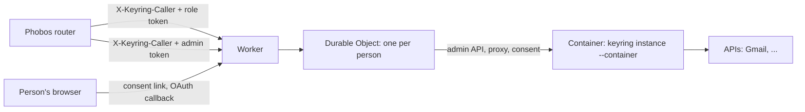

# Per-person keyrings on Cloudflare Containers

One keyring per person (gitmoot/keyring#46, option B1). The keyring binary is unchanged: each person gets a container running `keyring instance --container`, controlled by one Durable Object (DO) per person. The owner's Mac install does not use any of this.



## What lives where

The DO keeps each item under its own storage key, so writers of different items never overwrite each other. A delete sets a flag before its first await: after that, nothing starts the container or writes storage, and the container is destroyed even while it is still starting.


| Item | Where | Notes |
|---|---|---|
| Key values, roles, services | the container's memory, and the DO as a **sealed state** (AES-256-GCM) | the DO never decrypts it |
| Data key | derived by HKDF from the `MASTER_KEY` secret and a random per-keyring salt kept in the DO | deleting the DO's storage destroys the salt, so no copy of the state can be opened again |
| Daily counts | the container; the DO saves `GET /usage` every minute and before stopping the container, and passes it back on unlock | a restart does not reset a daily limit |
| Consent links | the container's memory | the DO keeps the container running until the last link and its sign-in have expired (#50) |
| Audit | the container's stdout (Workers logs) | never a key value or token |
| Container disk | nothing | |

## Routes

- `/p/<keyring_id>/<service>/<path>`: proxy. Needs `X-Keyring-Caller` and `X-Keyring-Token`. The Worker checks the caller proof in constant time before the DO is touched and removes it; the DO and the keyring also never forward it.
- `/admin/instances...`: admin API for the router. Needs `X-Keyring-Caller` and `Authorization: Bearer <ADMIN_TOKEN>`:
  - `POST /admin/instances {"label"}` → 201 `{"keyring_id", "keyring_base", "role_token"}`. The role token is shown only once.
  - `POST /admin/instances/<id>/links {"service", "ttl_seconds", "label"}` → `{"url", "expires_at"}`
  - `GET /admin/instances/<id>/services` → `{"services": [{"name", "connected", "failing"}]}`
  - `PUT /admin/instances/<id>/services/<name> {"service": {...}, "access": {...}}`: exceptions to the template
  - `DELETE /admin/instances/<id>/keys/<service>`: revokes at the provider (OAuth) and deletes
  - `POST /admin/instances/<id>/role-token` → `{"role_token"}`; the old token stops working
  - `DELETE /admin/instances/<id>`: wipes the container and the DO's storage; repeating it returns 200
- `/connect/<keyring_id>/c/<link>` and `/connect/callback`: public pages for the person. A link opens only while that keyring's container is running and the link is open, so a stranger cannot wake a container. The callback finds its keyring through a short-lived `__Host-` cookie; the keyring itself still checks the OAuth state, PKCE and its own browser cookie.

## Deploying (needs the owner's approval: changes the Cloudflare account and costs money)

Inputs:

| Name | Kind | Value |
|---|---|---|
| `PUBLIC_BASE` | var in `wrangler.jsonc` | https origin of the Worker, e.g. `https://keyring.example.com` |
| `SERVICES_TEMPLATE` | var in `wrangler.jsonc` | services each keyring starts with, and the router role's access |
| `MASTER_KEY` | secret | `head -c32 /dev/urandom \| base64`. Losing it makes every keyring unreadable; rotating it needs a re-seal (not built yet) |
| `CALLER_SECRET` | secret | the router's `X-Keyring-Caller` value, one per Phobos server |
| `ADMIN_TOKEN` | secret | the router's admin bearer token |
| `OAUTH_CLIENT_SECRETS` | secret | JSON `{"GOOGLE_CLIENT_SECRET": "..."}`, pushed into every keyring |

Google: create an OAuth client (type "Web application") with redirect URI `<PUBLIC_BASE>/connect/callback`, and put its client id in the template.

```sh
cd deploy/cloudflare
npm ci
npx wrangler secret put MASTER_KEY        # and CALLER_SECRET, ADMIN_TOKEN, OAUTH_CLIENT_SECRETS
npx wrangler deploy                        # builds the image from the repository root
```

Deploying without editing `wrangler.jsonc` (for example from a checkout you do not change):

```sh
npx wrangler deploy \
  --domain connect.example.com \
  --var PUBLIC_BASE:https://connect.example.com \
  --var "SERVICES_TEMPLATE:$(cat /path/to/services-template.json)"   # optional; a JSON string is accepted
```

After `wrangler deploy` returns, the container image can stay "provisioning" for several minutes (seen: about 4). In that window new keyrings may start on the **old** image with the **new** template. Wait until `npx wrangler containers list` shows the application ready before creating keyrings.

`--domain` adds the Worker's custom domain and its DNS record only; other records in the zone are not touched. Until a Google OAuth client exists, the template's `REPLACE` client id only breaks the Gmail sign-in; fixed-key services, consent forms, the caller check and deletes all work. Add a fixed-key service to a keyring with `PUT /admin/instances/<id>/services/<name>`.

## Checking it without Cloudflare

`smoke/smoke.ts` runs the Worker and DO code in Bun against the real binary, with fakes for `cloudflare:workers` and the container runtime:

```sh
go build -o /tmp/keyring ./cmd/keyring
cd deploy/cloudflare && npm ci && npx tsc --noEmit
KEYRING_BIN=/tmp/keyring bun smoke/smoke.ts
```

`wrangler dev` with local containers was tried on the seat's Linux host. Workerd's egress sidecar timed out before it created the keyring container, so behaviour under the real Containers runtime (cold start, `monitor`, `signal`, sleep) is only verified after a first deploy.

## Limits

- One `MASTER_KEY` for all keyrings. A Cloudflare account compromise exposes all keys (the owner accepted this when choosing B1).
- Calls made after the last usage save are lost if a container crashes; this only matters for the daily limit.
- Consent links end if a container is stopped by the platform before they expire.
